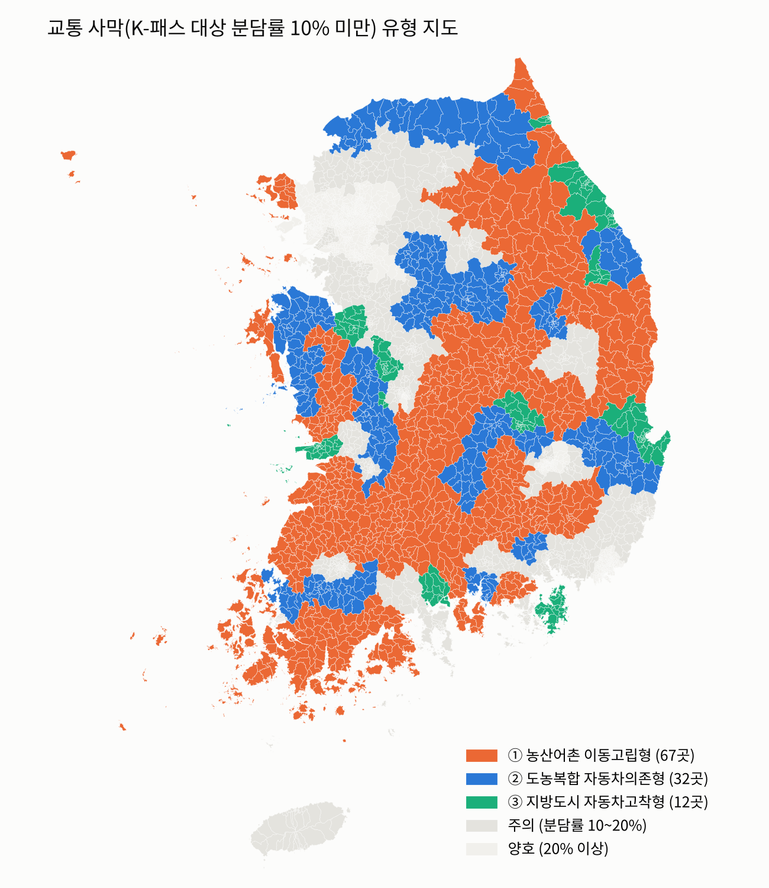

# 교통 사막에는 K-패스가 닿지 않는다

AI(SHAP 군집화)로 진단한 K-패스 혜택 격차와 지역 유형별 맞춤 이동 지원 방안
— 「AI와 함께하는 교통문제 해결을 위한 데이터 분석 공모전」 출품 코드

## 핵심 결과



| 질문 | 결과 |
|---|---|
| **K-패스 혜택은 고르게 돌아가나?** | K-패스 대상 수단 분담률 10% 미만인 **'교통 사막' 111개 시군구**에 인구의 **17.4%**가 살지만, 추정 환급액은 **4.8%**만 돌아감. 1인당 혜택은 대중교통이 좋은 지역이 사막 지역의 약 **5.3배** |
| **무엇이 분담률을 가르나?** | 분담률 예측 모델(GradientBoosting, 교차검증 **R² 0.93**)의 SHAP 분석 결과, **인구밀도**의 영향이 가장 크고 다음이 자가용 보유, 도시철도역 |
| **교통 사막은 모두 같은가?** | SHAP 값으로 군집화해 3개 유형 도출: ① 농산어촌 이동고립형(67곳, 고령 33%), ② 도농복합 자동차의존형(32곳), ③ 지방도시 자동차고착형(12곳, 승용차 통근 65%) → 유형마다 다른 처방이 필요 |
| **분석이 실제와 맞나?** | 2020년 자료로 만든 모델을 2026년 시도별 실제 K-패스 이용자 수와 비교해 상관 **0.94** (인구 1천 명당 0.86) |
| **무엇을 제안하나?** | ①에는 환급 대신 **선지급형 이동 크레딧**(약 9.2만 명, 연 176억 원, DRT 약 124대 규모), ②·③에는 자가용→대중교통 **전환 보너스**(목표 약 2.6만 명, 연 49억 원, CO₂ 약 3.5만 t 감축) |

※ 분석 단위는 2020년 행정구역 기준 전국 229개 시군구, 종속변수는 K-패스 대상 수단(시내·마을·광역버스, 전철·지하철) 통근·통학 분담률(인구총조사 2020)입니다. 교통 사막 기준(10%)을 8~15%로 바꿔도 혜택 격차(3.5~6.6배)는 유지됩니다.

**분석 흐름**: 변수 선정(VIF) → RandomForest/GradientBoosting/ExtraTrees 교차검증 → 정확(exact) SHAP → SHAP 기반 K-means → 세그먼트 회귀 정책 효율구간 → 2026년 자료로 적용·검증

## 실행 방법
```bash
pip install -r requirements.txt
python run_all.py          # 저장소 루트에서 실행
```
결과는 `data/`(통합 데이터), `out/`(분석 결과표), `fig/`(그림)에 생성됩니다.

원자료 없이 분석 단계만 재현하려면(저장소에 포함된 `data/sgg_master_v6.csv`, `work/`의 경계·2026 적용용 파일 사용):
```bash
python run_all.py --from 10   # 10_select_variables부터
```
원자료 전체 재현은 아래 표의 파일을 각 출처에서 내려받아 `data_raw/`에 표의 이름대로 저장한 뒤 `python run_all.py`를 실행합니다(용량 문제로 일부 원자료는 저장소에 포함하지 않음).

## 중간·결과 데이터 (`data/`)
`run_all.py`는 전처리 단계마다 `sgg_master_v1.csv` → … → `v7.csv`를 차례로 만듭니다(단계별 변수 추가). 저장소에는 재현에 필요한 두 개만 포함했습니다.
- `sgg_master_v6.csv`: 전처리 완료본(229개 시군구 × 63개 변수) — `--from 10`의 시작점
- `sgg_master_v7.csv`: 분석용 최종본(로그 변환 변수 추가)
- `final_vars.csv`: 최종 7개 변수와 VIF, `metro_stations_located.csv`: 시군구 배정된 도시철도역

## 원자료 (`data_raw/`)
| 파일 | 내용 | 출처 |
| --- | --- | --- |
| kosis_DT_1PA2004_2020.xls | 소요시간별/이용 교통수단별 통근통학 인구(시군구) | KOSIS, 국가데이터처 인구총조사 |
| kosis_DT_1PA2003_2020.xls | 성별/연령별/이용 교통수단별 통근통학 인구(시군구) | 〃 |
| kosis_DT_1PA2021_2020.xls | 현 거주지별/통근통학지별 통근통학 인구(시군구) | 〃 |
| kosis_DT_1B04006_2020_total.xlsx, _age.xls | 행정구역(시군구)별/1세별 주민등록인구 2020 | KOSIS, 행정안전부 |
| kosis_DT_1B040B3_2020.xlsx | 행정구역(시군구)별 주민등록세대수 2020 | KOSIS, 행정안전부 |
| kosis_DT_1B040M5_1_2023_2025.xls | 시군구/성/연령(5세)별 주민등록연앙인구 | KOSIS, 국가데이터처 |
| kosis_DT_MLTM_5498_2020.xls, _202608.xls | 자동차등록대수현황 시도별(시군구) | KOSIS, 국토교통부 |
| kosis_DT_MLTM_2300_2020.xls | 행정구역별·지목별 국토이용현황(지적통계) | KOSIS, 국토교통부 |
| bus_stops_20251031.csv | 전국 버스정류장 위치정보 | 공공데이터포털, 국토교통부(TAGO) |
| tago/*.csv | 버스노선정보(노선 목록·배차간격), `src/tago_collect.py`로 수집 | 공공데이터포털 OpenAPI, 국토교통부(TAGO) |
| metro_stations_20260630.xlsx | 전국도시철도역사정보표준데이터 | 공공데이터포털 |
| kpass_sido_202604.csv | K-패스 시도별 이용자 수(2026.4) | 국토교통부 공개 자료 |
| HangJeongDong_ver20201001.geojson | 행정동 경계(통계청 기준) | github.com/vuski/admdongkor |

**이용조건·출처 표시**
- 공공데이터포털 자료(버스정류장·버스노선·도시철도역사): 이용허락범위 제한 없음
- KOSIS·국토교통부 공개 통계: 출처를 밝혀 사용
- 행정동 경계: 출처 통계청 SGIS(sgis.kostat.go.kr), 가공 vuski/admdongkor (https://github.com/vuski/admdongkor), CC BY 4.0. `work/polys2020.pkl`은 이 경계를 시군구 단위로 합친 파생 자료입니다.

## 코드 구성 (`src/`, 파일 앞 번호가 실행 순서)
| 단계 | 파일 |
| --- | --- |
| 원자료 변환·정리 | 01_prepare_kosis, 02_build_mode_share, 03_mode_share, 04_age_commute, 05_kpass_share(종속변수), 06_population, 07_car_landuse, 08_age_rail, 09_bus_stops_spatial |
| 변수·모델·SHAP | 10_select_variables(VIF), 11_compare_models(교차검증), 12_shap_values |
| 군집·효율구간 | 13_cluster_k, 14_cluster_types(K-means), 15_cluster_profile, 16_policy_threshold(세그먼트 회귀) |
| 혜택·탄소·2026 적용 | 17_benefit_carbon, 18_car_scenario, 19_apply_2026, 20_tago_quality |
| 강건성·공간 | 21_robustness(탄소 효율·기준 민감도·밀도 통제), 22_spatial_autocorr(Moran's I·LISA) |
| 정책 수치 | 23_policy_numbers(선지급형 이동 크레딧 재원, 전환 보너스 비용) |
| 그림 | 24_figures_extra(보조 그림), 25_figures_report(보고서 그림 1~3) |
| 공통 모듈 | utils_regions(행정구역 이름 표준화), utils_shap(정확 Shapley 구현) |
| 수집 | tago_collect.py (본인 인증키 필요, 별도 실행) |

## 가정과 한계
- 혜택 추정: K-패스 1인당 월평균 환급 1.6만 원(2025년 1분기 보도). CO₂: 휘발유 2.18 kgCO₂/L(한국에너지공단 배출계수 산출), 연비 12 km/L, 통근 평균속도 35 km/h, 연 250일 왕복 가정.
- 통근·통학 수단은 최신 공표가 2020년(코로나19 시기). 정류장·노선은 최신 자료로 대체.
- 정책 수치: K-패스 첫 1년 환급금 3,600억 원(SBS Biz), DRT 대당 연 약 1.4억 원(경기 똑버스 2024, 경기일보). 전환 보너스의 전환 인원은 자가용 임계 시나리오의 목표치이며 보너스의 인과효과 추정이 아님.
- 2026 검증은 시도 단위 이용자 수(r=0.94)와 인구 1천 명당(r=0.86) 두 기준으로 제시.
- SHAP은 모델 기여이며 인과효과가 아님.

## AI 활용
분석 코드 작성·실행과 그림 제작에 Anthropic Claude를 활용했으며, 수치는 원자료 합계 대조·교차검증·SHAP 가법성 검증으로 확인했습니다.
